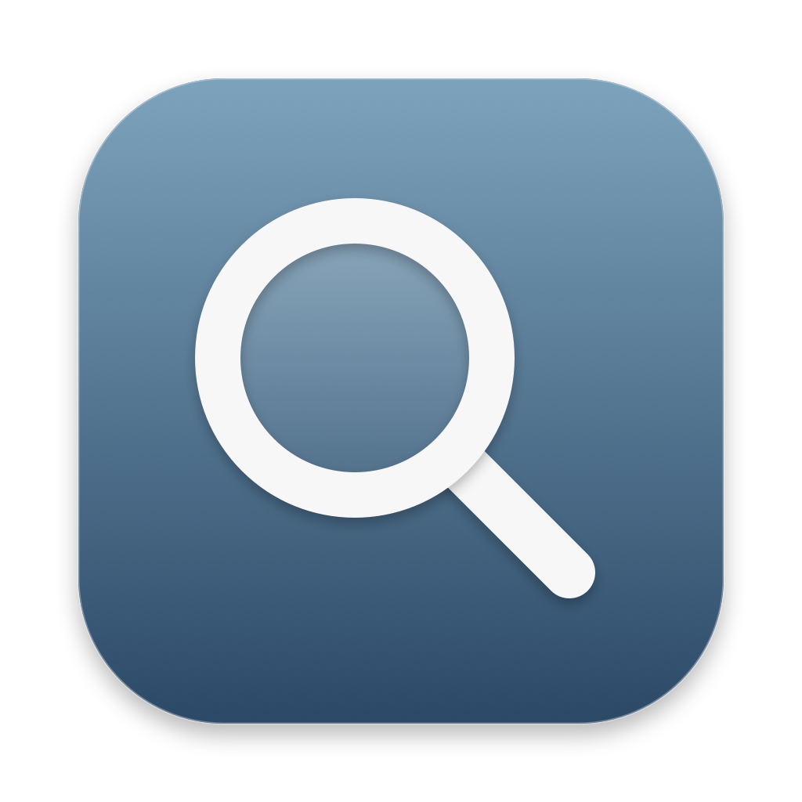

# Iron Search

A small, native macOS launcher for **applications and contacts only**. Press **⌘1** from any app to open a large, centered search panel using Apple's native Liquid Glass. Requires macOS 26 or later.



## Build and run

```sh
bash scripts/build.sh
open "dist/Iron Search.app"
```

The app lives in the menu bar. You can move the built app to Applications using Finder. To start it automatically, add it under System Settings → General → Login Items. No dependencies, accounts, or network services are required.

The build script uses standalone Apple Command Line Tools when installed, without changing your selected Xcode. The output is locally ad-hoc signed for development, not notarized for distribution. A Developer ID and notarization would be needed for normal distribution to other Macs. Build output matches the current Mac's architecture.

## Use

| Key | Action |
| --- | --- |
| ⌘1 | Show or hide search globally |
| ↑ / ↓ | Select a result |
| Return | Launch the app or show contact details |
| Escape | Back from contact details, or dismiss search |
| ⌥⌘0 / ⌥⌘1 / ⌥⌘2 | Filter All / Apps / Contacts |

Click a result to open it. Contact details have copy buttons for email addresses, phone numbers, and company names. Clicking outside dismisses the panel.

⌘1 is reserved globally while Iron Search is running, so applications won't receive their usual ⌘1 command. Quit from the menu bar to release it. If another global shortcut already owns ⌘1, Iron Search reports the conflict; you can still open search from its menu-bar icon. Spotlight and its ⌘Space shortcut are not changed.

## Search and privacy

- Applications are discovered recursively in `/Applications`, `~/Applications`, `/System/Applications`, and `/System/Library/CoreServices/Applications`. Safari's system Cryptex location and Finder are also included. Nested app bundles are skipped, and duplicate bundle identifiers are collapsed.
- Contacts are read from the macOS Contacts store, including accounts synced into that app. Click **Enable contacts** and grant macOS permission. Limited access searches only the allowed contacts. Denied access leaves application search usable.
- Search supports names, company names, email addresses, phone numbers, initials, and fuzzy app/name abbreviations. Accents and capitalization are ignored. Empty searches show up to eight entries, prioritizing recently launched apps.
- Indices refresh whenever search opens and through **Refresh Apps & Contacts** in the menu bar. Contact-store changes also trigger a refresh.
- Contact data stays in memory. Only the identifiers of the last 20 apps launched through Iron Search are saved in local preferences. There is no telemetry, upload, or contact export. Copying a field writes it to the macOS clipboard at your request.

## Verification

```sh
bash scripts/test.sh
```

This runs dependency-free checks for ranking, abbreviations, accent normalization, contact field searches, phone normalization, scope filtering, recents, limits, and empty results. Contacts permissions and global keyboard behavior also need interactive verification on the target Mac.

## Structure

- `Sources/SearchCore`: searchable records and deterministic ranking.
- `Sources/IronSearch`: native SwiftUI search panel, AppKit lifecycle, global hotkey, application indexing, and Contacts integration.
- `Resources/Info.plist`: app identity and Contacts permission description.
- `Resources/AppIcon.icns`: native multi-resolution app icon; `scripts/make-icon.swift` regenerates the vector-drawn artwork during builds.
- `scripts/build.sh`: builds and signs `dist/Iron Search.app`.

Inspired by the quick keyboard-driven launcher interaction in [Alfred](https://www.alfredapp.com/) and Spotlight, with a deliberately small scope.
